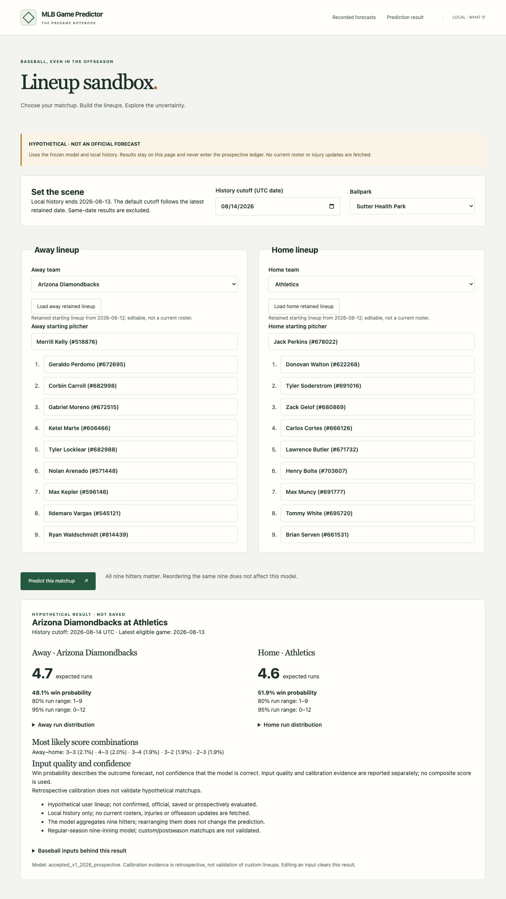
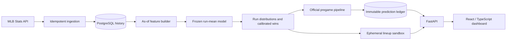

<div align="center">

# MLB Game Predictor

### Probabilistic baseball forecasting, from historical data to an interactive lineup sandbox.


[Results](#evaluation) · [Architecture](#architecture) · [Try it locally](#try-it-locally) · [Technical documentation](#technical-documentation)

</div>

An end-to-end sports analytics project that estimates how many runs each team will
score—and the uncertainty around those estimates. It combines MLB data ingestion,
cutoff-aware feature engineering, chronological model evaluation, calibrated win
probabilities, a typed API, and an interactive React dashboard.

The primary forecasting product targets confirmed starting lineups approximately
30 minutes before first pitch. An offseason **lineup sandbox** lets users choose
their own matchup and run the frozen model locally, without creating official
prediction records.

**Current status:** Local application implemented and verified. Cloud deployment
is deferred by choice. Reported model performance is retrospective development
evidence; the prospective prediction ledger is empty.

<details>
<summary><strong>See the lineup sandbox and an actual local-model result</strong></summary>



Actual inference from the accepted model using retained lineups. This is a
hypothetical matchup, not an official forecast or a performance claim.

</details>

## What it does

- **Forecasts both teams:** Expected runs, run distributions, calibrated win
  probabilities, most likely score combinations, and 80%/95% run ranges.
- **Supports custom matchups:** Search players by name, enter nine hitters per
  side, choose starters and a park, or load retained lineups and edit them.
- **Shows the evidence:** Raw and stabilized baseball inputs, sample sizes,
  fallback warnings, history cutoffs, and model/version provenance.
- **Separates uncertainty:** Outcome probability, input quality, and retrospective
  calibration evidence appear separately, without an invented confidence score.
- **Preserves the record:** Official forecasts retain immutable inputs/provenance;
  settlement is separate. Sandbox predictions are explicitly hypothetical and unsaved.

## Technical highlights

| Area | Implementation |
| --- | --- |
| Data engineering | Idempotent MLB Stats API ingestion, normalized PostgreSQL tables, stable entity IDs, source timestamps, and Alembic migrations |
| Leakage controls | Explicit `as_of` cutoffs, prior-date features, exclusion of same-day outcomes, and documented historical-lineup reconstruction |
| Model development | League/team baselines, Poisson and negative-binomial methods, histogram gradient boosting, rolling-origin evaluation, and feature ablations |
| Probability modeling | Negative-binomial run distributions, analytic score convolution, an extra-innings approximation, and Platt win-probability calibration |
| API and product | FastAPI/Pydantic contracts, React/TypeScript, browser-side Zod validation, accessible responsive views, and stale-response handling |
| Reliability | Checksum-verified frozen artifact, read-only API transactions, immutable official forecasts, pinned container runtime, and tested PostgreSQL backup/restore |

The accepted model uses **histogram gradient boosting with Poisson loss** for run
means, a **training-fold negative-binomial dispersion** for scoring uncertainty,
and **Platt calibration** for home-win probabilities. More elaborate matchup,
pitching, and environment features were evaluated in chronological ablations;
bundles without robust improvement were not promoted.

## Evaluation

Historical research covers the **2021–2025 regular seasons**, with expanding
rolling-origin evaluation across **2022–2025**. Game-level evaluation never uses
random train/test splits.

| Run-forecast metric | Result |
| --- | ---: |
| Mean absolute error | 2.4488 runs |
| Root mean squared error | 3.1304 runs |
| Poisson deviance — accepted mean model | 2.2765 |
| Poisson deviance — league-average reference | 2.3313 |
| Count negative log likelihood — negative binomial | 2.4132 |
| Count negative log likelihood — Poisson reference | 2.5746 |

For win calibration, each evaluation season's first 40% of dates fit the
calibrator; the remaining dates evaluate it. Across **5,928 evaluation games**:

| Win-probability metric | Before calibration | Platt calibration |
| --- | ---: | ---: |
| Brier score ↓ | 0.24558 | **0.24485** |
| Log loss ↓ | 0.68432 | **0.68266** |
| Expected calibration error ↓ | 0.02944 | **0.01717** |

These results informed model selection through repeated retrospective review.
They are **not an untouched final test or prospective validation**. See the
[final retrospective audit](docs/SPRINT8_FINAL_RETROSPECTIVE_AUDIT.md) and
[distribution audit](docs/SPRINT7_DISTRIBUTION_SIMULATION_AUDIT.md) for methodology,
coverage, comparisons, and limitations.

## Architecture



The official pipeline gates forecasts on lineup availability and pregame timing.
The optional sandbox reuses the accepted features and artifact through read-only
database transactions; it never writes to the official ledger. Administrative
fitting and ingestion remain outside HTTP request handlers.

## Try it locally

### Explore the interface without a database or model artifact

Requires Node.js 22.12+. From a fresh checkout:

```bash
make dashboard-install
make dashboard-dev
```

Open <http://127.0.0.1:5173/?demo=1&date=2026-08-14>.
This explicit demo uses **synthetic fixtures**, makes no API requests, and does
not run the model. It is a quick way to explore the forecast interface.

### Predict a custom lineup

Requires Python 3.12, Node.js 22.12+, the supported PostgreSQL 16 Compose service,
the trusted accepted model artifact, and normalized historical data. With those
local prerequisites already available:

```bash
make sandbox VENV=.venv-sprint10b
```

Open <http://127.0.0.1:8020/?sandbox=1>. Choose teams, pitchers, nine hitters per
side, a park, and a history cutoff, then select **Predict this matchup**. Stop the
server with Ctrl+C. Use `VENV=.venv-sprint0` instead if that is your installed
environment; Make commands target the supported local Compose database.

**A fresh clone does not contain the private frozen artifact, database, or raw
caches.** The synthetic demo works without them; real inference requires trusted
artifact/history recovery. See the [sandbox guide](docs/SANDBOX.md),
[runtime and recovery instructions](docs/RUNTIME.md), and
[detailed reproduction commands](docs/REPRODUCTION.md). Do not refit the accepted
model merely to recreate its artifact.

## Validation and reproducibility

Latest local verification, **November 1, 2026**:

- **99 Python tests passed**, with one opt-in PostgreSQL integration skip in the
  default suite; Ruff lint and formatting passed.
- **22 Chromium checks passed**, including real local-model inference, response
  validation, error states, mobile keyboard behavior, and automated accessibility.
- TypeScript checking and the Vite production build passed.
- Separate isolated PostgreSQL acceptance verified migrations, persistence,
  forecast immutability, settlement, and backup/restore.
- A normalized-state recovery rehearsal reproduced as-of features after restore.
  Real sandbox inference left all 18 domain-table row counts unchanged.

```bash
make quality VENV=.venv-sprint10b
make dashboard-test
```

The default browser suite uses fixtures; actual API/model checks are explicitly
opt-in. GitHub Actions workflows are defined for Python quality, frontend checks,
PostgreSQL/package acceptance, and infrastructure policy. The checks above were
verified locally; no remote CI status is claimed.

## Scope and limitations

- Historical starting lineups are reconstructed from game records, not archived
  T-minus-30 confirmation snapshots.
- Local history currently ends **August 13, 2026**. The sandbox exposes its cutoff
  and warns about stale history; it fetches no current rosters or injuries.
- The model aggregates the nine hitters. Changing their order alone does not
  change a prediction; custom roster and postseason scenarios are not separately validated.
- Regulation scoring assumes conditional home/away independence. Extra innings
  use a prior-training approximation.
- Distributions and score combinations label the tail **12+**. Uncensored count
  ranges are model quantiles, not guarantees of empirical coverage.
- Observed in-game weather and unpromoted research features are excluded from the
  accepted model. No prospective accuracy or deployed-cloud operation is claimed.

## Technical documentation

| Start here | Details |
| --- | --- |
| [Project specification](docs/PROJECT_SPEC.md) | Product scope, outputs, and success criteria |
| [Architecture](docs/ARCHITECTURE.md) | Data, modeling, API, and application boundaries |
| [Data rules](docs/DATA_RULES.md) | Leakage prevention, cutoffs, provenance, and fallback policy |
| [Frozen model specification](config/accepted_model_v1.json) | Accepted features, parameters, calibration, and limitations |
| [Lineup sandbox](docs/SANDBOX.md) | Local startup, custom lineups, contracts, and scientific boundaries |
| [API reference](docs/API.md) | Official forecast endpoints, readiness, and response semantics |
| [Explanation semantics](docs/EXPLANATIONS.md) | Baseball inputs, confidence, and uncensored ranges |
| [Reproduction guide](docs/REPRODUCTION.md) | Setup, ingestion acceptance, and research audit commands |
| [Release and recovery](docs/RELEASE.md) | Private packaging, infrastructure preparation, recovery, and rollback |
| [Decision log](docs/DECISIONS.md) | Modeling and engineering choices with rationale |

**Stack:** Python · pandas · NumPy · scikit-learn · SciPy · SQLAlchemy · Alembic ·
PostgreSQL · FastAPI · Pydantic · React · TypeScript · Vite · Zod · Docker · pytest ·
Ruff · Playwright · GitHub Actions
